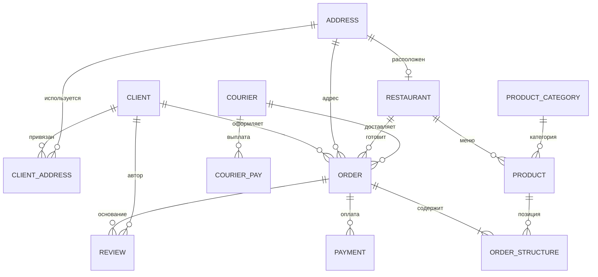

# Логическая модель FoodExpress

Источники: [ER-модель](../../docs/erd.md), [бизнес-правила](../../docs/company-rules.md), [тикеты](../../docs/backlog.md).  Схема `mineev_food`, расширение UUID в `exts`.

## Сущности

| Таблица | Первичный ключ | Основные атрибуты и связи |
|---|---|---|
| client | client_id | login, password, phone_number; логин и телефон — альтернативные ключи |
| address | address_id | street, house_number, apartment_office; уникальная тройка физического адреса |
| client_address | client_id, address_id | обе части — FK, связь M:N |
| restaurant | restaurant_id | restaurant_name, address_id (уникальный FK), description, work_start, work_end, company_details, rating, status |
| courier | courier_id | fio, phone_number, status, hire_date, dismissal_date, coefficient |
| courier_pay | year, month, courier_id | amount, coefficient_used; FK на courier |
| product_category | product_category_id | product_category_name |
| product | product_id | product_name, product_category_id, price, restaurant_id, photo_url, rating, status, description |
| order | order_id | courier_id, client_id, address_id, restaurant_id, order_timestamp, delivery_timestamp, order_amount, commission, total_amount, status, pay_status, description |
| order_structure | order_id, product_id | quantity, unit_price (цена на момент покупки) |
| payment | payment_id | order_id, payment_type, amount, transaction_id (уникальный UUID провайдера), transaction_timestamp, status |
| review | review_id | client_id, review_timestamp, entity_id, entity_type, order_id, description, photo_url, rating |

## ER-диаграмма

## Выбор типов

- `uuid` — все ID. Внешний `transaction_id` — UUID, который передает платежный провайдер; значение не генерируется по умолчанию.
- `numeric(14,2)` — деньги, чтобы не использовать двоичную арифметику. Комиссия и зарплата округляются до копеек; сумма позиций округляется после суммирования. `numeric(12,3)` — дробное количество. `numeric(3,2)` — рейтинг; `numeric(2,1)` — коэффициент.
- `varchar(N)` — ограниченные короткие строки; `text` — описания, реквизиты и URL. Телефон `char(12)`, генератор использует +7 и 10 цифр. В реальной БД международных номеров возможен другой формат.
- `date`, `timestamp`, `time` — как в исходном контракте, без индивидуальных часовых поясов. Часовой пояс базы — UTC. Месяц отчетности определяется по order_timestamp.
- 8 ENUM — статусы и типы в точном соответствии с BR.

## Функциональные зависимости и нормализация

В таблицах с составным ключом: `client_address` не имеет неключевых атрибутов; `order_structure.quantity` и `unit_price` зависят от пары (заказ, блюдо); `courier_pay.amount` и `coefficient_used` зависят от курьера и конкретного года/месяца. Хранить там текущее имя блюда или курьера не нужно. Названия категорий и сведения о ресторанах не дублируются в product. Клиент и его адреса вынесены в независимые сущности. Позиции заказа и попытки оплаты представлены отдельными строками, а не массивами повторяющихся столбцов.

В базовых сущностях неключевые атрибуты определяются ключами соответствующих отношений. Данные справочников не копируются в зависимые сущности. У составных ключей нет зависимостей от части ключа. Цена позиции не определяется только product_id, поскольку меню со временем меняется; это историческое значение конкретной покупки.

Осознанные исключения, требуемые контрактом: `order.commission` и `total_amount` вычисляются из `order_amount`; `order.pay_status` — агрегат платежей; `product.rating` и `restaurant.rating` — агрегаты отзывов; `review.client_id` функционально определяется `order_id`, однако сохранен для контракта и защищен составным FK. Это контролируемая избыточность физической модели, поэтому буквально считать все физические отношения строго 3НФ без этих оговорок нельзя. Логические исходные факты нормализованы, сохраненные производные значения согласованы ограничениями и триггерами. Полиморфный объект отзыва задается парой тип/ID, не является списком или неатомарным значением; валидность проверяется триггером.

## Политика истории

FK по умолчанию NO ACTION, без каскадного удаления адресов. Удаление записи, связанной с заказом, запрещено до удаления зависимых записей. Удаление клиента или ресторана, связанных с заказом, запрещено внешними ключами. Смена ресторана проданного блюда запрещена; цены меню могут меняться без изменения старой цены позиции. Полное удаление данных выполняет процедура `erase_test_data()`.
